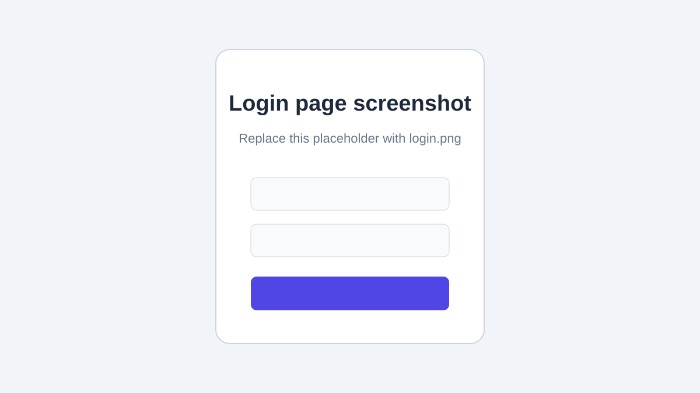
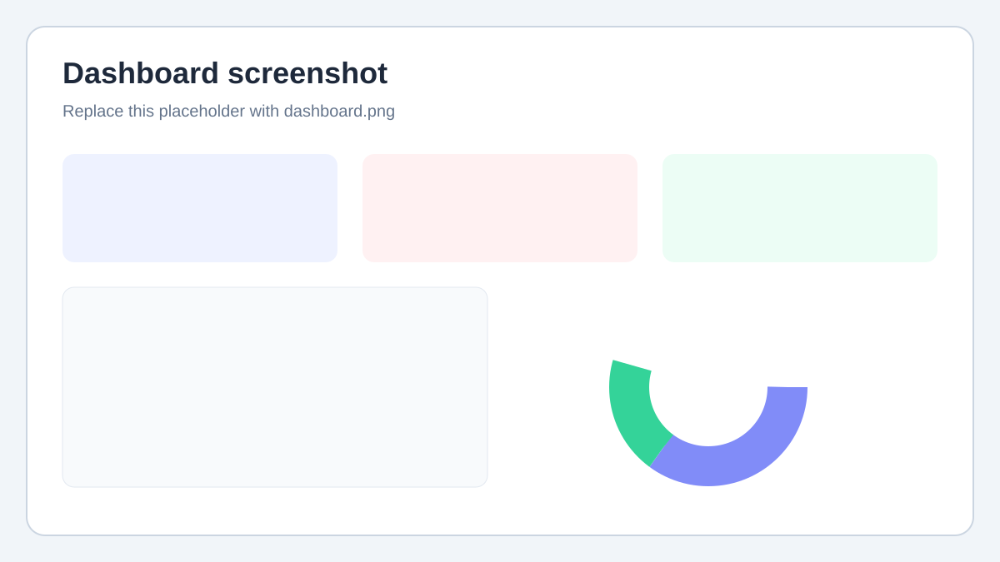
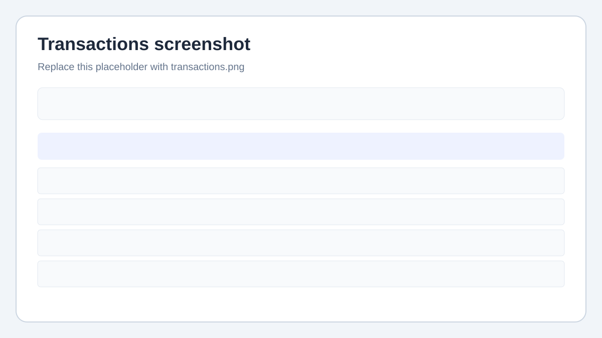
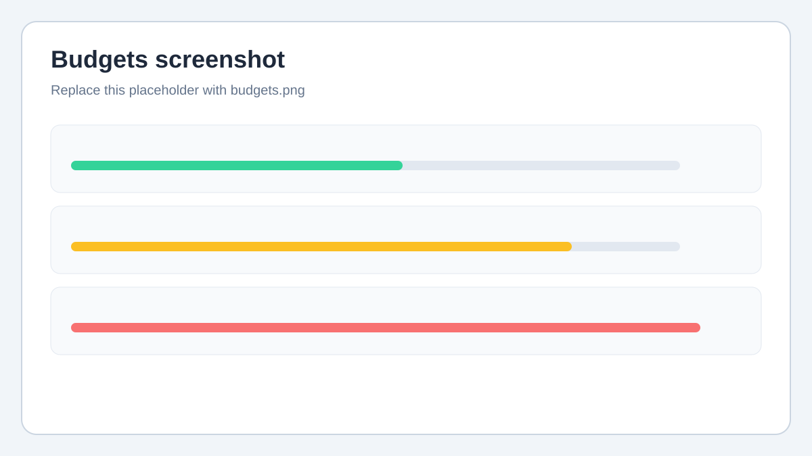

# Expense & Budget Tracker

A full-stack web application for tracking income and expenses, organizing transactions, setting monthly budgets, and viewing spending summaries and charts.

## Features

- Register and sign in with JWT authentication
- Dashboard with monthly income, expenses, balance, recent transactions, and charts
- Create, search, filter, sort, edit, delete, and export transactions as CSV
- Create and manage monthly category or overall budgets with spending progress
- Responsive React interface with form validation and error feedback
- Demo data seed script for trying the application

## Tech Stack

| Area | Technologies |
| --- | --- |
| Client | React, Vite, JavaScript, Tailwind CSS v4, React Router, Axios, Recharts |
| Server | Node.js, Express, Mongoose, MongoDB, JWT, bcryptjs, express-validator, Helmet, CORS |

## Project Structure

```text
.
├── client/
│   ├── public/
│   └── src/
│       ├── api/          # Axios client
│       ├── components/   # Shared UI and route components
│       ├── context/      # Authentication and toast state
│       ├── hooks/        # Reusable React hooks
│       ├── pages/        # Login, dashboard, transactions, budgets
│       └── utils/        # Date and currency helpers
├── docs/
│   └── screenshots/     # Replaceable screenshot placeholders
├── server/
│   ├── src/
│   │   ├── config/       # MongoDB connection
│   │   ├── controllers/  # Request handlers
│   │   ├── middleware/   # Authentication and validation
│   │   ├── models/       # Mongoose models
│   │   ├── routes/       # API routes
│   │   ├── scripts/      # Database seed script
│   │   └── utils/        # Shared server helpers
│   ├── app.js
│   └── server.js
├── package.json         # Root convenience scripts
└── README.md
```

## Prerequisites

- Node.js 20.19+ or 22.12+ and npm
- Git
- A MongoDB database: MongoDB Atlas or a local MongoDB server
- A GitHub account to push your project

## Setup

### 1. Clone the repository

```bash
git clone https://github.com/MohamedMuhthas/Expense-Budget-Tracker.git
cd Expense-Budget-Tracker
```

If your repository URL is different, replace the URL above with the HTTPS URL shown on your GitHub repository page.

### 2. Install server dependencies and configure the server

```bash
cd server
npm install
```

Copy `server/.env.example` to `server/.env` and set the values for your machine. For example, in PowerShell from the repository root:

```powershell
Copy-Item server/.env.example server/.env
```

Open `server/.env` in VS Code and replace `MONGO_URI` with your MongoDB connection string and `JWT_SECRET` with a long private random value. Never commit this `.env` file.

### 3. Install client dependencies

Open a second terminal at the repository root:

```bash
cd client
npm install
```

The client uses Vite's `/api` proxy to send API requests to `http://localhost:5000` during development. `client/.env.example` documents the optional currency setting.

### 4. Seed demo data (optional)

Make sure MongoDB is running and `server/.env` is configured. From the repository root:

```bash
npm run seed
```

Demo sign-in: `demo@example.com` / `DemoPass123!`. Use this only for local development; change or remove demo credentials before deploying publicly.

### 5. Run the apps

Open two terminals at the repository root. Start the server in the first terminal:

```bash
npm run dev:server
```

Start the client in the second terminal:

```bash
npm run dev:client
```

Open the Vite URL shown in the client terminal (normally `http://localhost:5173`). The API health check is `http://localhost:5000/api/health`.

### Build the client

```bash
npm run build
```

## Environment Variables

| Variable | App | Required | Description |
| --- | --- | --- | --- |
| `PORT` | Server | No | Server port; defaults to `5000` |
| `MONGO_URI` | Server | Yes | MongoDB connection URI, including the database name |
| `JWT_SECRET` | Server | Yes | Private secret used to sign seven-day JWTs; use a long random value |
| `CLIENT_URL` | Server | No | Allowed client origin for CORS; defaults to `http://localhost:5173` |
| `VITE_CURRENCY` | Client | No | Currency code used for display; defaults to `USD` |

Use `server/.env.example` and `client/.env.example` as templates. Keep actual `.env` files private.

## API Endpoints

Protected endpoints require `Authorization: Bearer <token>`. Transaction list filters can include `search`, `type`, `category`, `startDate`, `endDate`, `minAmount`, `maxAmount`, `sort`, `page`, and `limit`.

| Method | Endpoint | Authentication | Description |
| --- | --- | --- | --- |
| GET | `/api/health` | No | Check server health |
| POST | `/api/auth/register` | No | Register a user and return a token |
| POST | `/api/auth/login` | No | Sign in and return a token |
| GET | `/api/auth/me` | Yes | Get the signed-in user's profile |
| GET | `/api/categories` | No | Get supported income and expense categories |
| POST | `/api/transactions` | Yes | Create a transaction |
| GET | `/api/transactions` | Yes | List transactions with filters and pagination |
| GET | `/api/transactions/export` | Yes | Download filtered transactions as CSV |
| GET | `/api/transactions/:id` | Yes | Get one transaction |
| PUT | `/api/transactions/:id` | Yes | Update a transaction |
| DELETE | `/api/transactions/:id` | Yes | Delete a transaction |
| POST | `/api/budgets` | Yes | Create or update a monthly budget |
| GET | `/api/budgets?month=YYYY-MM` | Yes | List budgets with spending progress for a month |
| DELETE | `/api/budgets/:id` | Yes | Delete a budget |
| GET | `/api/dashboard?month=YYYY-MM` | Yes | Get monthly totals, recent transactions, and chart data |

## Screenshots

The images below are placeholders. Replace them with screenshots of the running application. If you use different filenames or image formats, update the Markdown image paths below. Store no more than five screenshots in `docs/screenshots/`.

### Login



### Dashboard with charts



### Transactions with filters



### Budgets


